<div align="center">


<br />

<a href="#features"></a>
<a href="#templates"></a>
<a href="#quick-start"></a>
<a href="#go-live"></a>
<a href="#brand-kit"></a>
<a href="#faq"></a>

<br />

**Auto captions and video editing for Reels, Shorts and YouTube.**<br />
Drop a video, get word-timed captions, style and edit them, then export an MP4, all in your browser, on a computer or a phone.

<a href="https://capmitra-app.vercel.app"></a>
<a href="https://ig.me/m/harshprajapatiofficial"></a>
<a href="#see-it"></a>



</div>

<a id="features"></a>

## ✦ Features

**🎙️ Auto captions**<br />
Speech becomes word-by-word captions with exact timing, in **34 languages**. Long videos are split automatically, and each video is transcribed only once.

**🌐 Three language choices**<br />
What's **spoken**, what the captions are **written in** (Gujarati script, Gujlish or roman letters) and an optional **translated second line**.

**🎨 46 animated templates**<br />
Our own **Electric Lime**, Spotlight, Boxed, Karaoke, One word, Neon, Royal gold and more, with full control of colour, outline, glow, highlight and motion.

**✂️ Video editing**<br />
Split, trim, reorder and join clips, **add more videos and images as clips** (at the end, at the playhead, or dropped onto a cut), with transitions, all on a **multi-track timeline**: video, captions, graphics, effects, sounds and music.

**🎬 Effects, music and sounds**<br />
27 video effects, 10 music styles and 26 sound effects, all generated by the app and free to use. Beat sync and keyword sync built in.

**🎯 Direct editing**<br />
Drag captions and graphics on the video with centre guides and snapping, **double-click any text to edit it in place**, drop a logo where you want it, and see **safe zones** for Reels, Shorts and TikTok.

**🏷️ Brand kits and batch**<br />
Save your logo, fonts, colours and intro/outro, apply them to any video, or caption several videos at once and **Export all**.

**🔒 Private by design**<br />
Your video never leaves your device. Only a small audio track is sent for speech to text. Optional team passcode.

**📤 Export anywhere**<br />
MP4 or WebM up to **4K**, rendered in your browser, plus SRT, VTT, word-timed VTT and plain text.

**🧠 AI tools, no API keys**<br />
**Edit by text** (delete words, pauses and filler words to cut the video), **long video → Shorts**, Gujarati and Hinglish **spelling check**, and **auto reframe** that keeps the speaker in frame. All run on your device.

**🎧 Audio Studio**<br />
**Noise reduction** and Studio, Podcast and Less echo voices, auto level, mute the original sound, and **music from your phone or computer** with volume and fades.

**⚡ Speed, cuts and live export**<br />
Clip speed from **0.25× to 4×** (voices keep their pitch), select anything on the timeline for its **action bar** (split, duplicate, options, delete), tap a cut to swap a transition or insert a clip, pinch and zoom the timeline on a phone, and a full-screen export that shows **every frame as it renders**, then saves wherever you choose.

<a id="see-it"></a>

## ▣ See it in action

A quick tour of the desktop editor, from setting up your key to the finished video. The demo clip is from [Spindia](https://www.youtube.com/@spindia007), used with permission.

### 1. Add your ElevenLabs key

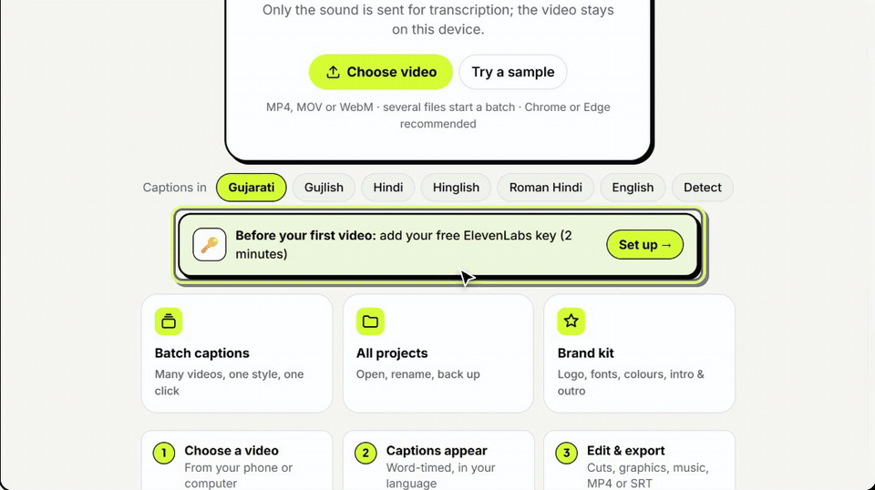

Paste your own free key once in **Settings**. It stays in this browser and is only ever shown masked.

### 2. Drop a video, get captions

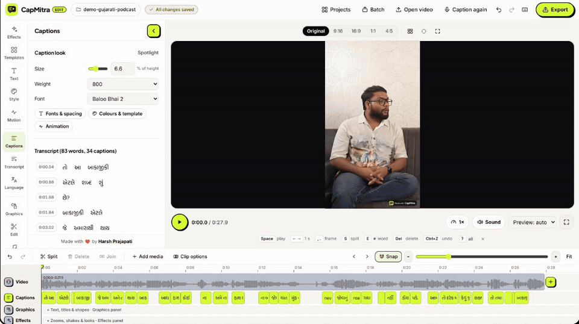

Pick the language and script, press **Generate captions**, and every word comes back with its own timing.

### 3. Pick a template

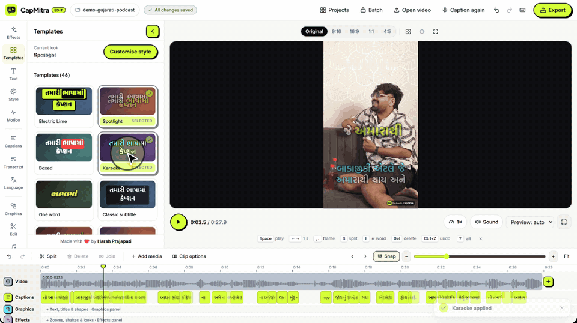

46 animated looks: karaoke, neon, word chips, chat bubbles and more. One tap applies it to every line.

### 4. Style it

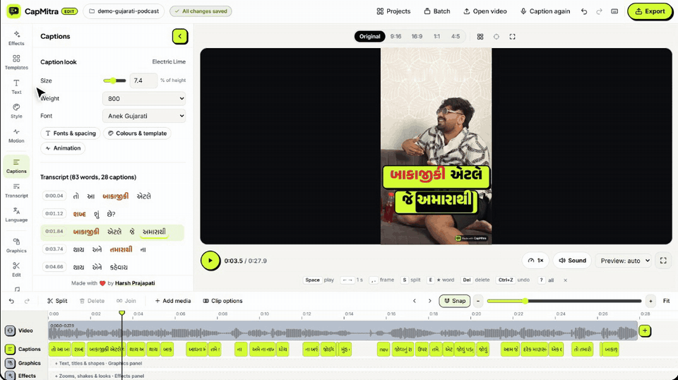

Caption size, a font for every script, and the highlight colour for the spoken word.

### 5. Edit any word in seconds

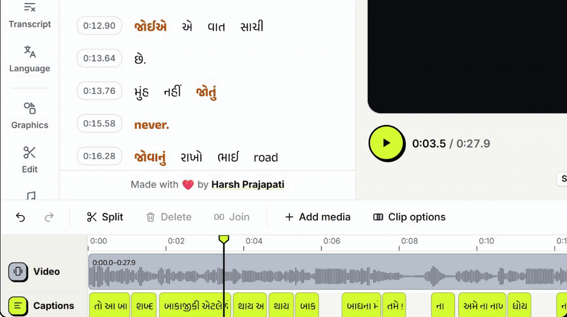

Click any word in the transcript and change how it is written, or add a headline and type straight onto the video.

### 6. Effects and transitions

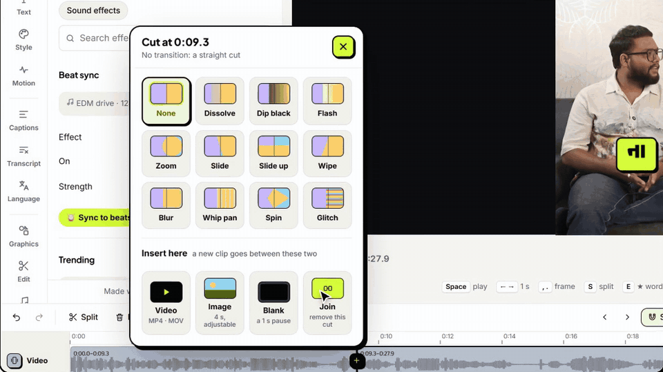

One-tap presets like Reels hype, split at the playhead with **S**, then pick a transition for the cut: cross dissolve, zoom, whip pan and more.

### 7. Clips and timeline

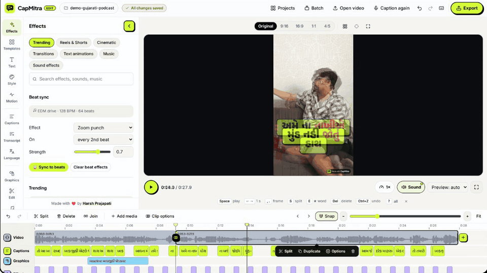

Add photos, title cards and clips, zoom in for frame-exact edits, then **Fit** to see the whole edit.

### 8. Your brand kit

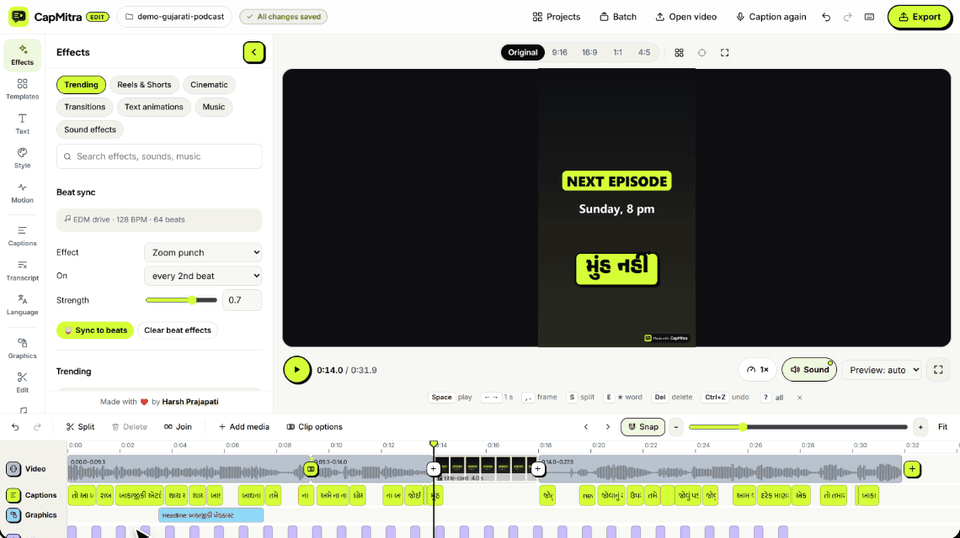

Save your logo, fonts and colours once, then apply them to any project in one click.

### 9. Export

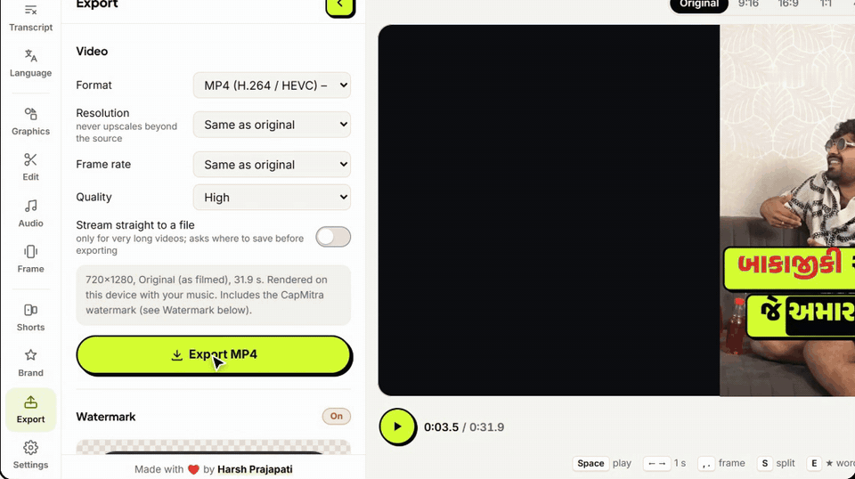

MP4 up to 4K, rendered right in your browser while you watch, or SRT and VTT subtitles.

### 10. Remove the badge with a code

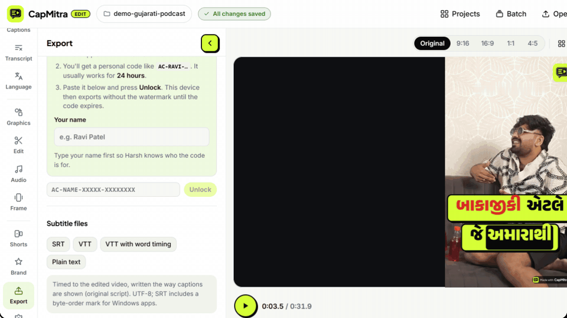

Free exports carry a small **Made with CapMitra** badge. Paste your personal code and it's gone.

### 11. Projects and backup

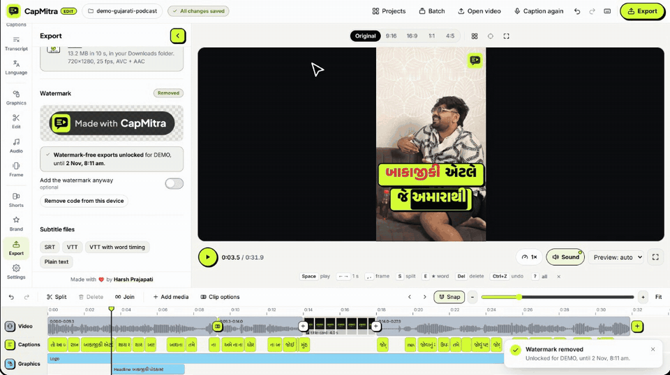

Every project saves on this device. Back them all up to one file and restore on any computer.

<a id="templates"></a>

## ▦ Templates, live

Every template preview is drawn by the same renderer as the export, so what moves here is exactly what lands in your video.

<div align="center">
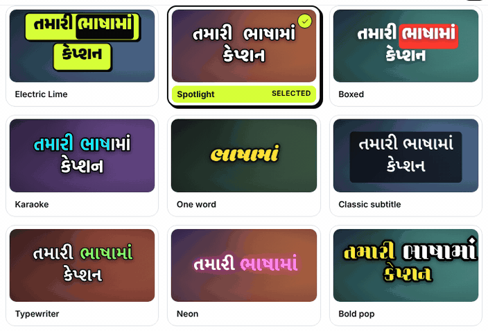
</div>

<details>
<summary><b>🎬 Effects, music and sounds in detail</b></summary>
<br />

Open the **Effects** panel. One click adds an item at the playhead. Everything lands on the timeline's **Effects** and **Sounds** tracks, where you can drag, adjust or delete it.

- **Trending**<br>One-click presets such as *Reels hype* (upbeat music, zoom punch on the beat, flash every bar, whoosh on cuts), *Keyword punch*, *Meme edit*, *Festive Gujarati*
- **Cinematic**<br>Bars, colour looks (warm, teal & orange, vintage, noir…), grain, light leaks, slow zoom
- **Transitions**<br>Cross dissolve, dip to black, flash, zoom, slide, whip pan, wipe, blur, spin, glitch
- **Text animations**<br>Caption entrances, including bounce, shake and glitch
- **Music**<br>10 styles composed by the app: lo-fi, pop, hip-hop, EDM, trap, cinematic, dhol, garba, corporate, piano
- **Sound effects**<br>26 sounds: whooshes, hits, pops, clicks, UI dings, fun sounds

- **Beat sync** puts an effect on every beat, every 2nd beat or every bar of the music.
- **Keyword sync** puts an effect on every highlighted word.
- **Effect packs:** import more items as a JSON file. The format is in [`docs/EFFECT_PACKS.md`](docs/EFFECT_PACKS.md).

</details>

## ⚙ How it works


- **Preview = export.** One canvas renderer draws the preview *and* every frame of the MP4, including Gujarati conjuncts like ક્ષ and સ્તે.
- **Hear = export.** Preview and export use the same volume maths (fades, music ducking under speech), and the export mix runs through a soft limiter.
- **Saved in your browser.** Projects, videos, transcripts, media, brand kits and batches live in IndexedDB on your device.
- **Several videos, one timeline.** Extra videos and images you add are stored as media on your device; each gets its own decoder on export, and captions always follow the main video.

<details>
<summary><b>🗂️ Project structure</b></summary>
<br />

```
app/
  page.tsx, layout.tsx          editor shell, fonts, SEO, loading screen
  styles/capmitra-brand.css      design tokens and base styles
  styles/workspace.css          editor layout: rail, panels, stage, timeline, phone layout
  api/transcribe, api/translate speech-to-text and translation proxies
  login/, proxy.ts              optional team passcode
  admin/, api/admin, api/unlock watermark codes: dashboard, sign-in, redeem
components/
  editor/                       editor state, workspace, stage, panels, hooks
  editor/QuickControls.tsx      Speed, Sound and cut sheets under the player
  editor/ExportOverlay.tsx      full-screen export with live preview
  timeline/MultiTrackTimeline.tsx  video, captions, graphics, effects, sounds and music
  ProjectsView.tsx              projects page
lib/
  renderFrame.ts, render.ts     one renderer for preview and export
  derive.ts, edl.ts             edit list: cuts, extra videos, image clips, transitions
  grouping.ts, animation.ts     caption grouping and word animation
  audioMix.ts, exportEngine.ts  mixing and MP4/WebM export
  saveSink.ts, livePreview.ts   saving straight to a file, live export preview
  timeStretch.ts                clip speed without changing the pitch
  voice/                        noise reduction and voice styles (RNNoise)
  textEdit.ts, shorts.ts        edit by text, long video to Shorts
  correct.ts, reframe.ts        spelling check, keep the speaker in frame
  effects/                      video effects, generated music and sounds, beat sync
tests/                          automated tests (npm test)
brand/capmitra/                 logo, icons and social images (SVG + PNG)
```

</details>

<a id="quick-start"></a>

## ▶ Quick start

> **You need** [Node.js 20+](https://nodejs.org) and an [ElevenLabs API key](https://elevenlabs.io/app/developers/api-keys) with Speech to Text access.

```bash
git clone https://github.com/xaviermsd/capmitra-app.git
cd capmitra-app
npm install
cp .env.example .env.local      # Windows: copy .env.example .env.local
npm run dev
```

Open **http://localhost:3000** in **Chrome or Edge** and drop a video. Add your key in `.env.local` (`ELEVENLABS_API_KEY=`) or inside the app under **Settings → Your ElevenLabs API key**.

<details>
<summary><b>🔑 All environment variables</b></summary>
<br />

| Variable | What it does |
|---|---|
| `ELEVENLABS_API_KEY` | Your own key. Online it's used **only by you**; everyone else adds their own key in Settings. |
| `SHARED_KEYS` | Who may use the server keys: `owner` (default), `everyone` (billed to you) or `off`. |
| `SARVAM_API_KEY` | Translated second line under the captions ([dashboard.sarvam.ai](https://dashboard.sarvam.ai)). |
| `APP_PASSCODE` | Locks the app behind a team passcode. Leave empty on your own computer. |
| `NEXT_PUBLIC_SITE_URL` | Your live URL, for link previews and the sitemap. |
| `NEXT_PUBLIC_ALLOW_INDEXING` | `true` lets search engines index the site. Default: not indexed. |
| `ADMIN_PASSWORD` | Opens **/admin**, where you create watermark-removal codes. |
| `WATERMARK_SECRET` | Long random string that signs the codes. Use the **same value** locally and on Vercel. |
| `WATERMARK_MASTER_CODE` | Your personal code: removes the watermark forever on any device you type it on. |
| `WATERMARK_REVOKED` | Switch codes off early (easier: **Revoke** on the admin page). |
| `KV_REST_API_URL`, `KV_REST_API_TOKEN` | Code history and revoking on Vercel. Added automatically when you connect **Upstash Redis**. |

</details>

<details>
<summary><b>🧰 Scripts</b></summary>
<br />

| Command | Use it to |
|---|---|
| `npm run dev` | Start the editor at http://localhost:3000 |
| `npm run fresh` | Clear the Next.js cache and start |
| `npm run build` then `npm start` | Run the production version locally |
| `npm run typecheck` | Check the TypeScript |
| `npm test` | Run the automated tests |

</details>

<details>
<summary><b>🩺 Troubleshooting</b></summary>
<br />

- **Page looks unstyled or old:** stop the server, run `npm run fresh`, then press <kbd>Ctrl</kbd>+<kbd>Shift</kbd>+<kbd>R</kbd>.
- **Buttons don't respond on `http://192.168…`:** open `http://localhost:3000` instead.
- **"No ElevenLabs API key":** add yours in **Settings**, or in `.env.local` and restart.
- **iPhone video won't play:** some iPhone videos use HEVC; use Chrome/Edge or convert to H.264 MP4.
- **A font couldn't load:** you need an internet connection the first time each font is used.

</details>

<a id="go-live"></a>

## ↗ Go live on Vercel

> About 15 minutes, all free. Sign up to [Vercel](https://vercel.com) **with GitHub**.

1. **Import** - [vercel.com/new](https://vercel.com/new) → import `capmitra-app`. Next.js is detected automatically.
2. **Environment variables** - copy these from your `.env.local`: `APP_PASSCODE`, `ADMIN_PASSWORD`, `WATERMARK_SECRET` (exactly the same value), `WATERMARK_MASTER_CODE`, `ELEVENLABS_API_KEY`.
3. **Deploy**, then add `NEXT_PUBLIC_SITE_URL` = your live link and **Redeploy**, so WhatsApp, Instagram and X show the CapMitra preview card.
4. **Code history (optional)** - **Storage → Create Database → Upstash (Redis)** → connect it → **Redeploy**.

<details>
<summary><b>👥 Sharing with friends: everyone uses their own key</b></summary>
<br />

Send them the link and passcode. Each person opens **Settings → Your ElevenLabs API key**, creates a free key (ideally restricted to **Speech to Text**) and taps **Save and test**. The key stays only in their browser. Your server key is used only on your own devices.

</details>

<details>
<summary><b>💧 Watermark and admin codes</b></summary>
<br />

Every MP4 carries a small **Made with CapMitra** badge inside the safe zone. **Export → Watermark** shows people how to ask for removal on [Instagram](https://ig.me/m/harshprajapatiofficial) or [WhatsApp](https://wa.me/919898528376).

Open **`/admin`** with `ADMIN_PASSWORD` to create codes (1 hour to forever), send them on WhatsApp, see who used them, and **revoke** any time. Codes are signed with `WATERMARK_SECRET`, so nobody can make one up.

</details>

<a id="brand-kit"></a>

## ◐ Brand kit


Logos, icons and social images (SVG + PNG) are in [`brand/capmitra/`](brand/capmitra/). The social preview is [`docs/readme/social-preview.png`](docs/readme/social-preview.png).

<details>
<summary><b>⌨️ Keyboard shortcuts</b></summary>
<br />

| Keys | Action |
|---|---|
| <kbd>Space</kbd> | Play / pause |
| <kbd>←</kbd> / <kbd>→</kbd> | Seek 1 s (hold <kbd>Shift</kbd> for 5 s) |
| <kbd>,</kbd> / <kbd>.</kbd> | Step one frame back / forward |
| <kbd>S</kbd> | Split at the playhead |
| <kbd>Delete</kbd> | Delete the selected item |
| <kbd>Ctrl</kbd>+<kbd>Z</kbd> / <kbd>Ctrl</kbd>+<kbd>Shift</kbd>+<kbd>Z</kbd> | Undo / redo |
| <kbd>Ctrl</kbd>+<kbd>D</kbd> | Duplicate the selected graphic |
| <kbd>Ctrl</kbd> + scroll | Zoom the timeline |
| <kbd>?</kbd> | All shortcuts |

</details>

<a id="faq"></a>

## ? FAQ

<details>
<summary><b>Is it free?</b></summary>
<br />
The app is. Speech to text uses ElevenLabs credits (there's a small free monthly allowance). Styling, editing and export run on your computer and cost nothing.
</details>

<details>
<summary><b>Does it work for Hindi, Hinglish and English?</b></summary>
<br />
Yes, 34 languages in all. Pick the spoken language in the <b>Language</b> panel, or a quick preset such as Hindi, Hinglish or English.
</details>

<details>
<summary><b>Where are my projects stored?</b></summary>
<br />
In your browser on that device. Use <b>Projects → Back up all</b> to move them to another computer. Your original video files are never changed.
</details>

<details>
<summary><b>Which browsers work?</b></summary>
<br />
Chrome or Edge on Windows, Mac or Android for everything, including MP4 export. For quicker exports on a phone, pick 1080p in Export → Resolution. On iPhone, captioning and editing work, but Safari may not support MP4 export.
</details>

<details>
<summary><b>Do the AI tools cost anything?</b></summary>
<br />
No. Edit by text, Shorts, spelling check, auto reframe and noise reduction all run on your device with open-source models, so there are no API keys or per-use costs. Only speech to text uses ElevenLabs.
</details>

<details>
<summary><b>Can I post videos with the built-in music and sounds?</b></summary>
<br />
Yes. They're generated by the app's own code, so there's nothing to license. If you add your own music, make sure you have the rights to it.
</details>

<br />

<a href="https://www.instagram.com/harshprajapatiofficial/"></a>

<div align="center">
<sub>Made with ❤️ by <a href="https://www.instagram.com/harshprajapatiofficial/"><b>Harsh Prajapati</b></a></sub>
</div>
